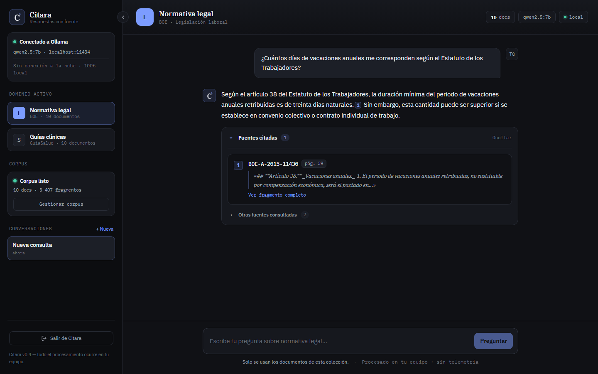
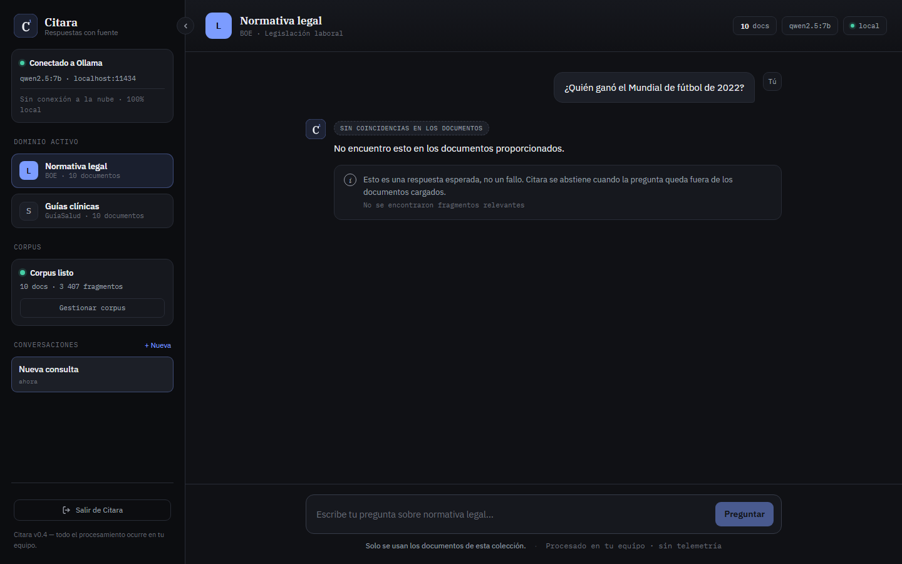
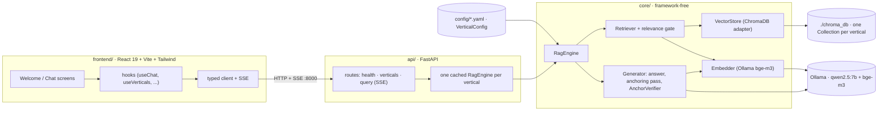

# Citara

**Local, private, cited RAG over Spanish public documents.** One vertical-agnostic engine,
two demos from the same codebase: **legal** (BOE legislation) and **health** (GuíaSalud
clinical guidelines). Every answer is grounded in the retrieved fragments, carries inline
citations verified against the source, and the engine **abstains** when the documents do not
support an answer. Everything runs offline on a single 8 GB GPU: no cloud, no API keys,
no telemetry.

[](./LICENSE)

[](https://github.com/AxelAxx/Citara/actions/workflows/ci.yml)


> Portfolio project, feature-complete and frozen at v0.4. Not a certified legal or clinical
> tool. Public documents only; no personal or patient data.

<p align="center">
  
</p>

<p align="center"><sub>Sped up 2.5x. A real answer takes one to two minutes on the RTX 1080 used for development.</sub></p>

<p align="center">
  
</p>

<p align="center">
  
</p>

## What this project demonstrates

- **Clean Architecture that paid for itself.** `core/` has no web or UI framework imports and
  no vertical-specific branches. The presentation layer was migrated from Streamlit to
  React + FastAPI with **zero changes to `core/`**. The frozen Streamlit app is still in the
  repo (`app.py`, `ui/`) as the empirical proof.
- **Grounding is a type, not a convention.** `Answer` cannot be constructed without citations
  unless it is the abstention object. Citations are derived from retrieval and sent over the
  wire *before* the first token, so the model never chooses its own sources.
- **"The LLM proposes, a deterministic guard disposes."** Inline citation chips come from a
  second constrained-JSON pass, then an `AnchorVerifier` repairs or drops each chip by relative
  cosine margin. The prose is never modified, only the chips.
- **Abstention by resolved state.** Whether an answer counts as an abstention is decided from
  the final structured result (zero verified chips and the exact abstention sentence), never by
  pattern-matching the model's prose. A per-vertical relevance gate and an `AnswerabilityGate`
  (calibrated on a labeled set, see `docs/b2/`) force the exact abstention upstream.
- **Honest engineering record.** Thresholds were calibrated by measurement, limitations are
  written down with reproduction steps, and a reverse-engineering audit of the repo itself
  lives in `docs/audit/` with every finding anchored to `file:line`.

## How it works



**Query path.** The client posts a question to `/api/verticals/{id}/query` and receives a
Server-Sent Events stream: the `citations` event first (fixed the instant retrieval returns),
then `token` events as the model writes clean prose, then a single `done` event with the
authoritative resolution (`is_abstention`, `suppress_citations`) and the answer as typed
parts (text runs interleaved with citation chips). The full contract is in
[`docs/API_CONTRACT.md`](./docs/API_CONTRACT.md).

**Ingestion path.** `python -m core.ingest --vertical <id>` loads the PDFs under
`data/<id>/` with `pymupdf4llm`, chunks them by tokens (600 tokens, 90 overlap), embeds them
with the same `bge-m3` model used at query time, and upserts into a per-vertical ChromaDB
collection. Ingestion is idempotent.

**One engine, many verticals.** Everything that differs between legal and health lives in
`config/legal.yaml` and `config/health.yaml`: display copy, example questions, the system
prompt, `top_k`, the relevance threshold, and whether the answerability gate is enabled. There
is no `legal.py`.

## Stack

| Layer | Technology |
|---|---|
| LLM | Qwen2.5 7B via Ollama (`/api/chat`, streamed) |
| Embeddings | BGE-M3 via Ollama (`/api/embed`, batched) |
| Vector store | ChromaDB (persistent, one collection per vertical) |
| PDF extraction | pymupdf4llm (AGPL-3.0, see [`docs/DECISIONS.md`](./docs/DECISIONS.md)) |
| Chunking | langchain-text-splitters, token-based with tiktoken |
| API | FastAPI + sse-starlette |
| Frontend | React 19, TypeScript, Vite, Tailwind |
| Tests | pytest, 137 tests, no live Ollama or Chroma needed |

Hardware used for development and calibration: one RTX 1080 (8 GB VRAM, Pascal). Both models
run fully on the GPU.

## Quickstart

Prerequisites: [Ollama](https://ollama.com), Python 3.11+ (developed on 3.14, CI runs 3.11 and
3.12), Node 20+, and a GPU with roughly 8 GB of VRAM (CPU works, slowly).

```bash
# 1. models (one-time, ~6 GB)
ollama pull qwen2.5:7b
ollama pull bge-m3

# 2. python env
python -m venv .venv && source .venv/bin/activate   # Windows: .venv\Scripts\Activate
pip install -r requirements.txt

# 3. frontend deps (one-time)
cd frontend && npm install && cd ..
```

**Corpus.** The PDFs are not committed (size and redistribution terms). Download them and
drop them into `data/legal/` and `data/health/`. The file name (without `.pdf`) becomes the
`document_id` shown in citations, so use short kebab-case names.

- **Legal** (consolidated texts from the [BOE](https://www.boe.es)): Constitución Española
  (BOE-A-1978-31229), Código Civil (BOE-A-1889-4763), Código Penal (BOE-A-1995-25444),
  Estatuto de los Trabajadores (BOE-A-2015-11430), Ley de Arrendamientos Urbanos
  (BOE-A-1994-26003), Ley de Enjuiciamiento Civil (BOE-A-2000-323), Ley General Tributaria
  (BOE-A-2003-23186), Ley 39/2015 (BOE-A-2015-10565), Ley 40/2015 (BOE-A-2015-10566),
  LOPDGDD (BOE-A-2018-16673).
- **Health** (clinical practice guidelines from [GuíaSalud](https://portal.guiasalud.es)):
  ansiedad, asma, cáncer colorrectal (cribado), depresión, diabetes tipo 2, embarazo y parto,
  EPOC, hipertensión, ictus, insuficiencia cardíaca.

```bash
# 4. ingest (offline, idempotent; a few minutes per vertical on an 8 GB GPU)
python -m core.ingest --vertical legal
python -m core.ingest --vertical health
```

**Run.** Ollama must be running (`ollama serve`). Then, in two terminals from the repo root:

```bash
uvicorn api.main:app --port 8000      # backend, Swagger at http://localhost:8000/docs
```

```bash
cd frontend && npm run dev            # frontend at http://localhost:5173
```

Open http://localhost:5173, pick a vertical, and ask in Spanish. The first question after
start-up waits for the model warm-up behind the splash screen.

**Tests and checks.** Same steps CI runs (`.github/workflows/ci.yml`); nothing needs Ollama.

```bash
pip install -r requirements-dev.txt    # pytest, ruff, httpx (+ playwright for captures)
```

```bash
ruff check . && ruff format --check . && pytest -q    # 137 passed, fully mocked
```

```bash
cd frontend && npm run lint && npm run build
```

## Repository layout

```
core/        framework-free engine: models, ingest, embed, store, retrieve, generate, engine
api/         FastAPI adapter over the RagEngine façade (SSE streaming)
frontend/    React SPA (Vite + Tailwind); src/lib holds the pure helpers, src/hooks the state
config/      one VerticalConfig YAML per vertical (legal, health)
data/        corpora (PDFs, git-ignored)
tests/       pytest suite with mocked Embedder / Generator / store
docs/        SPEC, glossary, API contract, decisions, audit, B2 measurement set
scripts/     read-only diagnostics and measurement harnesses
app.py, ui/  legacy Streamlit presentation, frozen and unmaintained (requirements-legacy.txt)
```

Tooling: `pyproject.toml` (ruff + pytest config), pinned `requirements*.txt`, GitHub Actions CI.
Release history in [`CHANGELOG.md`](./CHANGELOG.md).

## Known limitations

Written down on purpose. The project is closed at this state.

- **Header-only chunks in the health corpus.** Some GuíaSalud pages extract as nothing but the
  running header, and those tiny chunks can win retrieval for questions phrased by the guide's
  title ("¿Qué recomienda la guía sobre...?"), which then abstain. Questions phrased by clinical
  content work. Diagnosis in [`docs/audit/06-readiness.md`](./docs/audit/06-readiness.md).
- **First-person out-of-corpus questions (B2).** A 7B model answers personal questions
  ("¿cuánto IRPF me toca pagar?") with a polite prose decline instead of the exact abstention.
  Fixed for legal by the `AnswerabilityGate`; the residual health case is tracked, not built.
  See [`docs/KNOWN_LIMITATION_B2_first_person_out_of_corpus.md`](./docs/KNOWN_LIMITATION_B2_first_person_out_of_corpus.md).
- **Latency.** On a 2016 GPU an answer takes one to two minutes including the anchoring pass.
  The UI streams tokens and labels each phase honestly rather than hiding it.
- **Licensing.** `pymupdf4llm` is AGPL-3.0, so the project is AGPL-3.0. A proprietary fork
  would need a different PDF loader.

## Documentation

- [`docs/SPEC.md`](./docs/SPEC.md): requirements, architecture, acceptance criteria.
- [`docs/UBIQUITOUS_LANGUAGE.md`](./docs/UBIQUITOUS_LANGUAGE.md): the project vocabulary, used verbatim in code.
- [`docs/API_CONTRACT.md`](./docs/API_CONTRACT.md): the HTTP + SSE frontier.
- [`docs/DECISIONS.md`](./docs/DECISIONS.md): architecture and licensing decisions with rationale.
- [`docs/audit/`](./docs/audit/): reverse-engineering audit of the repo (diagrams, drift, readiness).
- [`docs/b2/`](./docs/b2/): the answerability measurement set and results behind the gate thresholds.
- [`PROGRESS.md`](./PROGRESS.md) and [`ROADMAP.md`](./ROADMAP.md): build log and the roadmap that was deliberately not pursued (Spanish).
- [`CLAUDE.md`](./CLAUDE.md): the operating guide used with Claude Code during development.

## License

[AGPL-3.0](./LICENSE). Corpus documents keep their own licenses (BOE reuse terms, GuíaSalud).
