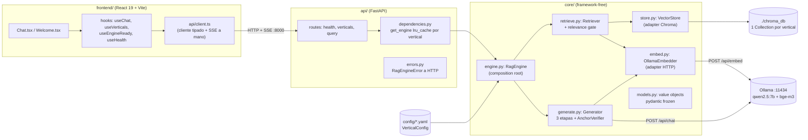

# 02 — Mapa de arquitectura y módulos

> Auditoría read-only sobre `2bd0ded`. Arquitectura por capas con dependencias apuntando
> hacia dentro: Presentation (React / API) → Application (`engine.py`) → Domain (`core/`
> restante), con los adapters concretos (Ollama/Chroma/PyMuPDF) aislados en módulos designados.

## Vista global (arquitectura VIVA)

## `core/` — el motor (Domain + Application)

| Módulo | Responsabilidad | Símbolos clave |
|---|---|---|
| `models.py` | Value objects pydantic frozen `extra="forbid"` + excepciones específicas. Invariantes TIPADAS: un Answer no-abstención exige ≥1 Citation (`:225-235`); un CitePart fuera de rango no puede existir en un Answer (`:237-253`) | `Chunk` (con `embedding` transiente `:71-90`), `Citation`, `AnswerPart = TextPart \| CitePart` (unión discriminada `:177`), `CiteAnchor`, `VerticalConfig` (`:289-357`), `RagEngineError` y 4 subclases accionables |
| `ingest.py` | Loader + Chunker + driver offline + CLI. ids deterministas sha1(document_id, page, index) para upsert idempotente (`:78-87`); tokens-no-caracteres vía `length_function` inyectada (`:169-210`) | `DocumentLoader`, `Chunker`, `discover_corpus`, `ingest`, `persist`, `load_vertical_config` (:354, el ÚNICO lector de YAML), `main` (:386) |
| `embed.py` | Puerto `Embedder` (ABC `:59-73`) + adapter `OllamaEmbedder` por HTTP directo (el SDK está documentado como inviable `:8-14`). Batching anti-overload (`:159-170`), preflight `check_health` (`:116-128`) | `Embedder`, `OllamaEmbedder`, `_model_is_available` |
| `store.py` | Adapter ChromaDB (chromadb importado SOLO aquí, lazy `:318`). Frontera de aplanado de metadata (`flatten_metadata :54-72`); query devuelve `QueryHit` con distance y embedding (`:76-93`); `include=["embeddings",...]` para el verificador (`:191-196`) | `VectorStore`, `QueryHit`, `flatten_metadata` |
| `retrieve.py` | `Retriever.retrieve(query, top_k, relevance_threshold)` — embed de la Query con el MISMO Embedder de ingesta, búsqueda, **relevance gate** (`:111-118`), reconstrucción `QueryHit`→`Chunk` (`rebuild_metadata :37-64`, frontera inversa del aplanado) | `Retriever`, `rebuild_metadata` |
| `generate.py` | El módulo más denso: guard duro de abstención (`:455-456`), prompt con bloques citables + títulos humanos (`_format_block :665-684`), 3 etapas de citación (ver 03-flujo), strip simétrico de abstención (`:354-387`), dedup fragmento→cita (`:724-743`), AnchorVerifier (`verify_anchors :213-306`), llamadas HTTP streamed/no-streamed a /api/chat | `Generator`, `ABSTENTION_TEXT` (:71), `split_into_sentences`, `anchor_citations`, `verify_anchors`, `_cosine`, `strip_abstention_phrase`, `_parts_from_anchors` |
| `engine.py` | **Composition root** (`from_vertical_config :138-183` — el único sitio que instancia adapters concretos) + caso de uso: `answer` (`:198`) y `answer_stream` (`:213`) que devuelve `StreamedAnswer` (`:44-88`): citations fijas al retornar retrieval + stream de parts + seam `resolve_parts` para el cierre | `RagEngine`, `StreamedAnswer` |

### ¿Se respetan las reglas de oro? (verificado)

- **"core/ sin frameworks de UI/web": SE CUMPLE.** Grep de imports en `core/`: los únicos third-party son requests/chromadb/pymupdf4llm/tiktoken/langchain_text_splitters/yaml, todos lazy y todos en su módulo adapter designado. Cero streamlit/fastapi/react en core (verificado por grep de `import streamlit|fastapi` → solo `ui/` y `app.py`).
- **"cero lógica de vertical en core/": SE CUMPLE.** No existe ningún `if vertical ==` en `core/` (el único uso de `Vertical` es como dato/enum de provenance). Todo lo que difiere entre legal y health entra por `VerticalConfig`. Matiz honesto: `_OFFICIAL_ID_RE` (`ingest.py:57`) reconoce ids tipo BOE, pero es lógica de provenance genérica documentada como tal (`:54-56`) — dispara sobre cualquier filename con ese patrón, sin consultar el vertical.

## `api/` — capa HTTP fina

- `main.py`: app + CORS solo `http://localhost:5173` + registro de handlers + 3 routers.
- `dependencies.py:18-34`: `get_engine(vertical_id)` con `@lru_cache` — **un engine construido+warmed por vertical, cacheado a vida del proceso**; ids inválidos no envenenan la cache (lru_cache no cachea excepciones).
- `errors.py:24-38`: tabla única `RagEngineError`→(status, error_code): 503 ollama_unreachable/model_not_pulled/retrieval_failed, 409 empty_corpus, 500 engine_error; `ValueError` de `Vertical(...)`→404 unknown_vertical (`:52-59`).
- Rutas: `GET /api/health` (preflight agregado + publica `abstention_text` — fuente única para el front), `GET /api/verticals` (proyección `VerticalView` que OCULTA system_prompt/corpus_path/collection_name, `schemas.py:22-35`), `GET /api/verticals/{id}/corpus`, `POST /api/verticals/{id}/query`.

### Contrato del endpoint query (`api/routes/query.py`)

`POST /api/verticals/{id}/query` con body `{query: str}` (`schemas.py:16-19`) → `EventSourceResponse` con orden estricto **`citations → token* → done | error`** (`_stream_events :35-124`):

1. `citations` (`:60-69`): las Citations fijadas en el instante en que retrieval retorna, con `is_abstention` PROVISIONAL (= citations vacías).
2. `token` (`:71-77`): fragmentos de texto según el LLM los emite.
3. `done` (`:86-124`): la resolución autoritativa — parts anclados (vía `resolve_parts`, la 2ª+3ª etapa) + `is_abstention` decidido sobre el ESTADO RESUELTO (`:107`), + `suppress_citations`. **No lleva campo de texto**: el texto final viaja solo dentro de los TextParts.
4. `error` (`:78-85`): fallo de generación mid-stream como evento terminal (el status HTTP ya salió).

Errores PRE-stream (vertical desconocido, retrieval caído) NO son eventos: el retrieval corre eagerly en `answer_stream` antes del primer byte SSE (`:24-31`), así que salen como respuestas JSON de error normales.

## `frontend/` — SPA React

- **`api/client.ts`**: tipos del contrato espejados 1:1 (`Citation`, `AnswerPart`, `DoneEvent`… `:15-89`) + `streamQuery` (`:156-226`): **SSE a mano** — `fetch` POST + `body.getReader()` + parser de frames propio (`dispatchFrame :208-235`), con `AbortSignal` opcional para cancelación real de transporte (`:160-165`). Por qué no EventSource: es GET-only y no parsea eventos con nombre (documentado `:148-155`).
- **`hooks/useChat.ts`**: la máquina de estados de conversación. `MessagePhase = thinking | writing | anchoring | done | error` (`:12`); watchdog de silencio de 700ms que detecta el hueco del anchoring (`:22-31`); reset + `AbortController` al cambiar de vertical (`:80-95`, el fix del hilo mixto); `threadRef` monotónico contra callbacks tardíos.
- **`components/chat/Message.tsx`**: dos modos de render por fase — texto acumulado en vivo (con `hideTrailingAbstention :31-50`, limpieza cosmética del stream) vs `renderParts` (`:56-96`) en done: map directo sobre los parts tipados de core, chips con stagger CSS (`--cite-i`), CERO parseo de marcadores en el front.
- **`components/chat/CiteChip.tsx`**: el chip numérico, 2 variantes (`card` panel / `inline` texto), animación de entrada solo inline.
- **`components/chat/SourcesPanel.tsx`**: `splitCitations` (`:28-44`, pura y exportada) parte las citations en "Fuentes citadas" (ancladas por algún CitePart, conservan su `n` original) vs "Otras fuentes consultadas" (recuperadas pero no citadas, plegadas); click en chip → unfold + scroll + flash de la card (`:169-186`).
- **`App.tsx`**: flujo de pantallas como unión discriminada `View` (`:15-18`): Splash → Welcome → WarmUpGate (`useEngineReady`: GET /health ES el warm-up del engine + precarga de verticales/corpus) → Chat.
- **`theme/accent.ts`**: paleta por vertical swapeada en `:root` (`setAccent :46-53`); vertical sin paleta → throw (fail-fast).

## `config/` — cómo el YAML cambia el comportamiento sin tocar core

`VerticalConfig` (`models.py:289-357`) es el ÚNICO canal de variación. Campos de comportamiento y su consumidor:

| Campo YAML | Efecto | Consumidor |
|---|---|---|
| `collection_name` | Qué Collection de Chroma se abre | `engine.py:151` |
| `top_k: 6` / `relevance_threshold: 1.05\|0.90` | Ventana y gate de retrieval | `engine.py:199-204` → `retrieve.py:111-118` |
| `system_prompt` | TODAS las reglas de grounding/abstención/tono (incluido el puente de 1ª persona, solo legal) | `generate.py` vía `engine.py:156` |
| `document_titles` | Títulos humanos en el header del bloque de contexto (anti-misattribution) | `generate.py:665-684` |
| `inline_citation_mode: structured\|off` | Si corre la 2ª pasada de anchoring o no | `generate.py:573` |
| `anchor_repair_margin: 0.05` / `anchor_support_floor: 0.50` | Calibración del AnchorVerifier | `generate.py:587-595` vía `engine.py:164-170` |
| `example_questions`, `domain_*` | Presentación pura (Welcome/EmptyState/Sidebar) | `api/schemas.py:22-48` → front |

## Símbolos NO presentes en `UBIQUITOUS_LANGUAGE.md` (concepto nuevo sin glosar — deuda de glosario)

| Símbolo | Dónde | Qué es |
|---|---|---|
| `StreamedAnswer` | `core/engine.py:44-88` | El gemelo streaming de Answer: part_stream + citations + seam `resolve_parts`. Concepto central del caso de uso vivo |
| `ABSTENTION_TEXT` | `core/generate.py:71` | La frase de abstención como constante (fuente única); glosado el concepto "Abstention", no el identificador |
| `strip_abstention_phrase` | `core/generate.py:354` | El strip simétrico leading+trailing |
| `QueryHit` | `core/store.py:76-93` | El resultado crudo del store (id/text/metadata/distance/embedding) |
| `LoadedPage`, `IngestedChunk`, `IngestionResult` | `core/ingest.py:112,216,225` | Los value objects intermedios de la ingesta |
| `MessagePhase` (y la fase `anchoring`) | `frontend/src/hooks/useChat.ts:12` | El ciclo de vida del mensaje en el front |
| `hideTrailingAbstention` | `frontend/src/components/chat/Message.tsx:31` | Limpieza cosmética del stream vivo |
| `hadCandidates` | `frontend/src/components/chat/AbstentionNote.tsx` | El discriminador hard/soft del copy del pill |
| `EnginePreload` / `VerticalCorpus` | `frontend/src/hooks/useEngineReady.ts:8`, `useVerticals.ts:5` | Los agregados de precarga del front |
| `VerticalView` / `QueryRequest` | `api/schemas.py:16,22` | Los DTOs de la API |
| `Chunk.embedding` (campo transiente) | `core/models.py:83-89` | Extensión del término glosado `Chunk` para el AnchorVerifier |

**Drift de glosario detectado**: la entrada **App** (`UBIQUITOUS_LANGUAGE.md:70`) sigue definida como "The Streamlit presentation layer" — desactualizada tras la migración. Y `top_k` se glosa con default **5** (`:52`) mientras ambos YAML usan **6** (documentado en los YAML como recalibración; el default 5 sigue siendo el de `models.py:310`).

## LEGACY — `ui/` + `app.py` (Streamlit, CONGELADO)

**No es arquitectura viva**: es la Presentation original, congelada como red de seguridad de la migración (así documentado en `requirements.txt:16` y `docs/DECISIONS_merged.md`). `app.py` (entrada `streamlit run app.py`) + `ui/` (layout, theme, state, 7 componentes, 2 screens). Consume core por la MISMA fachada (`RagEngine`, `load_vertical_config`) — la limpieza de esta frontera es lo que hizo barata la migración (registrado en DECISIONS). **Riesgo de deriva conocido**: `ui/layout.py:105` conserva la regla de abstención ANTIGUA (`text.strip().startswith(ABSTENTION_TEXT)`) que la API viva ya reemplazó por autoridad resolved-state — si alguien reactivara Streamlit, su comportamiento de abstención diferiría del actual. No recibe mantenimiento (los fixes de esta historia no lo tocaron).
