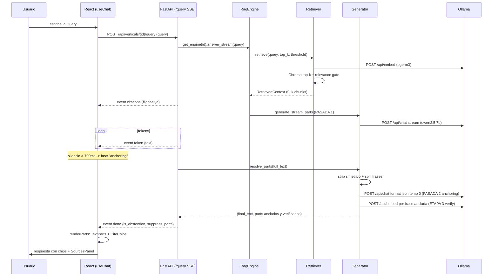
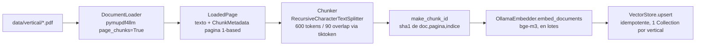

# 03 — Flujo del caso de uso principal: Query → respuesta con citas en la UI

> Auditoría read-only sobre `2bd0ded`. Este es el recorrido completo de una pregunta,
> con los puntos más preguntables en entrevista: el relevance gate, la generación en
> TRES etapas y la abstención real de hoy. La ingesta offline va al final, separada.

## Diagrama de secuencia (camino feliz, modo `structured`)



## Paso a paso

### 0. Front → API

`ChatInput`/`EmptyState` → `useChat.send(query)` (`useChat.ts:103`): añade el mensaje user + un assistant en fase `thinking`, y llama `streamQuery(verticalId, query, handlers, signal)` (`client.ts:156`) — body `{query}` a secas, sin historial: **la API es stateless por pregunta**.

### 1. Engine por vertical + retrieval eager

`query.py:23-32`: `get_engine(vertical_id)` (lru_cache por vertical, `dependencies.py:18`) y `answer_stream(body.query)` — el retrieval corre ANTES del primer byte SSE, así los errores pre-stream salen como JSON normal (`query.py:26-30`).

### 2. Retrieval + **relevance gate por vertical**

`engine.py:229-234` pasa `top_k` y `relevance_threshold` desde config. En `retrieve.py`:

- Embed de la Query con `embed_query` sobre el MISMO `bge-m3` de ingesta (`:102` — regla de oro 4 por construcción).
- Chroma devuelve top-k *nearest* — nunca "near enough" — así que el **gate** filtra (`retrieve.py:111-118`):

```python
relevant = [
    hit for hit in hits
    if hit.distance is not None and hit.distance <= relevance_threshold
]
```

- Umbral **por vertical, calibrado empíricamente** (comentado en los YAML): `legal.yaml:27` → **1.05** (gap medido: peor in-domain 0.976 vs mejor off-domain 1.149); `health.yaml:29` → **0.90** (0.848 vs 0.964). Distancia = L2² de Chroma sobre vectores unit-norm (menor = más cerca). Sin default en el modelo (`models.py:319`, `Field(gt=0.0)`) — falta el valor ⇒ falla la carga de config, fail-fast.
- Si TODO cae → `RetrievedContext` vacío → abstención determinista aguas abajo. Los hits que pasan se reconstruyen a `Chunk` con su `embedding` a bordo (`retrieve.py:120-131`, transiente, para la etapa 3).

### 3. Evento `citations` — fijadas antes de generar

`engine.py:236-237`: las Citations derivan del contexto en el instante en que retrieval retorna (`_citations_from_context`, `generate.py:701-722` — dedup por `(document_id, page)`, orden de relevancia, primera aparición aporta el `chunk_text` del visor). La API las emite como primer evento (`query.py:60-69`).

### 4. Generación en **TRES etapas** (no dos)

**PASADA 1 — la respuesta** (`generate_stream_parts` → `_invoke_llm_stream`, `generate.py:889+`): `POST /api/chat` streamed, temp 0.1, con el `system_prompt` del vertical + el user turn de `_build_prompt` (`:648-663`): bloques numerados `[i] [Documento: <título humano> — <id>, pág. N]` (`_format_block :665-684`) + la pregunta. El modelo escribe **prosa limpia sin marcadores** (regla explícita del prompt). Guard duro previo: contexto vacío ⇒ la frase de abstención entera, **sin llamar al LLM** (`:493-495`; camino no-streaming idéntico `:455-456`).

**PASADA 2 — anchoring estructurado** (`anchor_citations`, `generate.py:605-635`): al cerrar el stream, `resolve_parts(full_text)` (seam de `StreamedAnswer`, `engine.py:244-247`) dispara la segunda llamada LLM: frases numeradas (`split_into_sentences :110-149`, segmentador determinista es-ES con lista de abreviaturas que preserva byte-a-byte el texto) + los MISMOS bloques numerados de la pasada 1, con `format:"json"` y **temperatura 0** (`:619-621`). Respuesta esperada: `{"anchors":[{"sentence":i,"chunk":j}]}`. Validación fail-safe (`_parse_anchor_json :161-199`): JSON roto → cero anclas; entrada fuera de rango 1..N → descartada; duplicados colapsados. **Aditiva por contrato**: cualquier fallo degrada a respuesta sin chips, jamás rompe la respuesta (`:487-489` — hasta el error de transporte se traga aquí, documentado).

**ETAPA 3 — AnchorVerifier** (`verify_anchors`, `generate.py:213-306`, insertado en `_resolve_parts :583-595`): el 7B propone anclas in-range pero a veces **semánticamente falsas** (medido: página-índice anclada cuando el contenido vivía en otra página). El verificador, determinista:

1. Embebe cada frase anclada (mismo `bge-m3`; cache por frase) y puntúa coseno contra **cada citation** de su propio contexto — chunks agrupados por la clave del dedup (`fragment_to_citation`), así dos chunks de la misma (doc, page) cuentan como un solo destino.
2. Tres ramas, en orden de precedencia (`:293-306`): **discard** si ni el argmax llega a `anchor_support_floor` (0.50 — nada respalda la frase, chip fuera); **repair** si el argmax supera al anclado por más de `anchor_repair_margin` (0.05 — remapea al mejor chunk del argmax); **keep** en empates (ambigüedad legítima de páginas adyacentes, medida en 0.005-0.03).
3. Degradaciones aditivas: sin embedder cableado, chunk sin vector, o fallo transitorio de embed → anclas del modelo intactas (`:262-268,275-283`).

Regla relativa y no umbral absoluto **por medición**: las anclas falsas conocidas puntuaban DENTRO del rango de las correctas (0.61-0.73 vs 0.59-0.80); lo que separa es el margen al argmax. Calibración registrada en `DECISIONS_merged.md` (n=40 + smoke en vivo). ¿Qué pasa si un ancla no verifica? — o se repara al chunk correcto (caso índice→p.62, reproducido en vivo), o se descarta su chip; la prosa nunca se toca.

**Ensamblado** (`_parts_from_anchors :309-352`): frases → TextParts; tras cada frase anclada, un CitePart por citation DISTINTA (`n` ya remapeado por el dedup `_fragment_index_to_citation_index :724-743`, 1-based sobre `citations`); TextParts adyacentes se fusionan; la concatenación de TextParts reproduce el texto final byte a byte.

### 5. Abstención — el comportamiento REAL de hoy

Dos mecanismos coordinados, ambos sobre ESTADO (nunca sobre startswith de prosa cruda):

- **Strip simétrico** (`strip_abstention_phrase`, `generate.py:354-387`): elimina UNA ocurrencia byte-exacta de `ABSTENTION_TEXT` al INICIO y/o al FINAL del texto (con su whitespace), nunca mid-text, nunca paráfrasis. Corre lo primero en `_resolve_parts` (`:570-572`) con **guard de abstención-pura**: si el strip vaciaría el texto (la frase ES toda la respuesta), se conserva el original. Motivo medido: el 7B a veces APPENDEA la frase tras una respuesta real (cola) o la ENCABEZA antes de contenido citado — ambas son autocontradicciones que se limpian en la única sede de resolución.
- **Autoridad resolved-state en el done** (`query.py:86-107`): camino duro — `citations == []` ⇒ abstención, un solo TextPart, `resolve_parts` ni se llama (`:86-92`). Con citations, la resolución corre SIEMPRE y `is_abstention = (cero CiteParts) AND (texto resuelto == ABSTENTION_TEXT byte-exacto)` (`:107`) — cero CiteParts a solas no basta porque modo `off` y anchoring degradado producen respuestas grounded sin chips. `suppress_citations == is_abstention`.
- A nivel de TIPO, una abstención con chips es imposible: `models.py:237-253`.
- Limitación conocida (no cubierta por diseño): el prose-decline del 7B en preguntas personales fuera de corpus — `docs/KNOWN_LIMITATION_B2_first_person_out_of_corpus.md`.

### 6. El front consume

`useChat` acumula tokens en fase `writing`; 700ms de silencio del stream ⇒ fase `anchoring` ("Verificando fuentes…" — detección, no delay artificial, `useChat.ts:22-31`); en `done`, `Message.renderParts` (`Message.tsx:56-96`) pinta los parts tipados — los chips resuelven `citations[n-1]`, click → unfold+scroll+flash de la card en `SourcesPanel`, que además parte citadas/consultadas (`splitCitations`, `SourcesPanel.tsx:28-44`). Cambio de vertical mid-stream: aborta el fetch (AbortController) y resetea el hilo (`useChat.ts:80-95`).

**Latencia, dicho claro**: en modo `structured` los chips llegan con el `done` unos segundos DESPUÉS del último token (la pasada 2 es una segunda llamada LLM sobre el texto completo) — trade-off aceptado y documentado (`query.py:96-104`); el usuario ya está leyendo la respuesta completa mientras tanto.

## Pipeline de INGESTA (offline, separado del query path)

`python -m core.ingest --vertical <legal|health>` (`ingest.py:386-430`):



1. **Descubrimiento** (`discover_corpus :242-267`): PDFs bajo `corpus_path`, `document_id` estable (id oficial BOE del filename o slug, `derive_document_id :60-70`); corpus vacío ⇒ `EmptyCorpusError` accionable.
2. **Loader** (`DocumentLoader :124-166`): `pymupdf4llm.to_markdown(page_chunks=True)`, páginas numeradas 1-based por enumeración (no se confía en metadata posiblemente 0-based); páginas en blanco se saltan. Cada página lleva su `ChunkMetadata` — la provenance que hace posible cada Citation.
3. **Chunker** (`:169-210`): `chunk_size=600` / `chunk_overlap=90` desde config, medidos en **TOKENS** vía `length_function` inyectada (tiktoken `cl100k_base` como proxy; sin ella el splitter contaría caracteres — trampa documentada `:172-176`). Todo Chunk hereda la metadata de su página.
4. **Ids deterministas** (`make_chunk_id :78-87`): sha1(document_id|page|index-en-página) ⇒ re-ingestar **upsertea** en las mismas filas (AC1 idempotencia; el upsert en `store.py:114-154`).
5. **Persistencia** (`persist :311-343`): preflight de Ollama ANTES de embeber (`main() :416` — nunca una Collection corrupta a medias), `embed_documents` en lotes pequeños (el runner de Ollama se satura con lotes grandes, `embed.py:159-170`), listas paralelas → `upsert`. El Embedder se construye del MISMO `VerticalConfig.embedding_model` que usará el query path: ingest y query no pueden desincronizar modelos (regla de oro 4).
