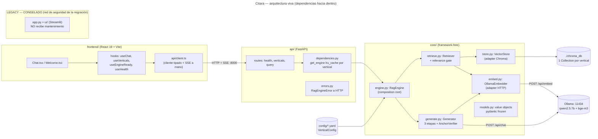
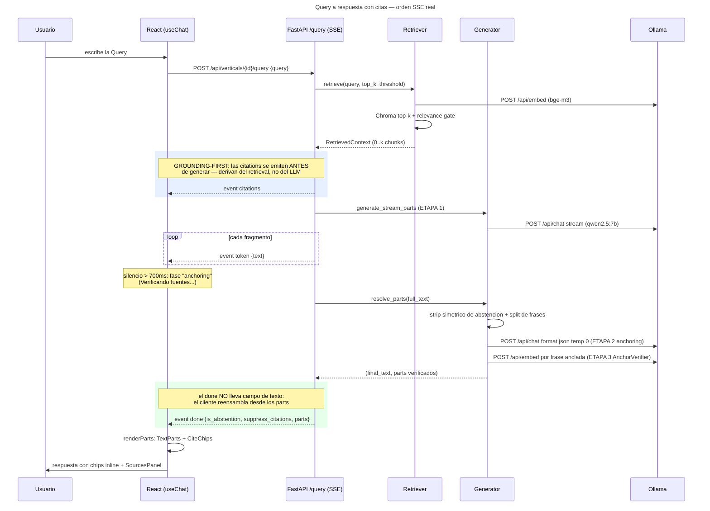
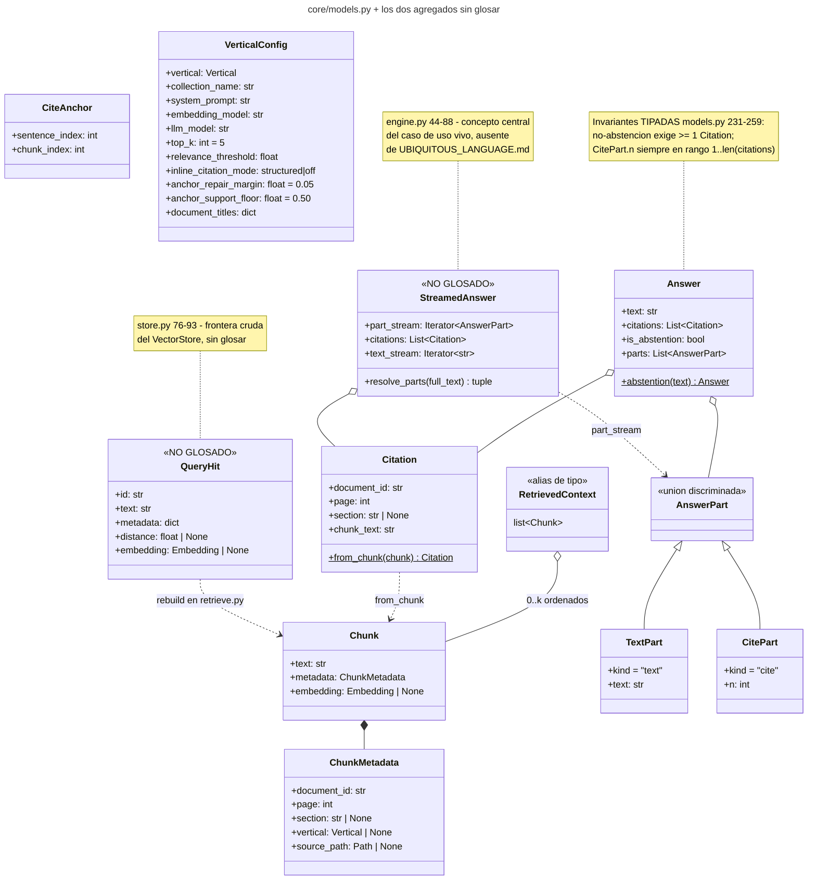
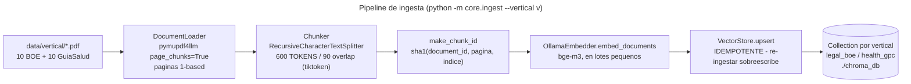
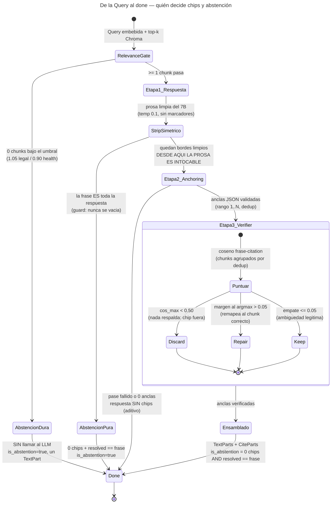

# 04 — Diagramas de presentación

> Auditoría read-only sobre `2bd0ded`. Cinco diagramas Mermaid autoexplicativos, anclados al
> código. Sin ER clásico: no hay BD relacional — la persistencia es ChromaDB (vectores +
> metadata plana).

## 1. Arquitectura de alto nivel (versión canónica)

Tres capas vivas con dependencias apuntando hacia dentro: React consume la API por HTTP+SSE, la
API resuelve un `RagEngine` cacheado por vertical (`api/dependencies.py:18`) y `core/` aísla los
adapters concretos en módulos designados (`store.py:318`, `embed.py`, `generate.py`). El bloque
Streamlit está deliberadamente sin flechas: congelado, no participa del flujo vivo
(`requirements.txt:16`).

## 2. Secuencia del caso de uso principal (grounding-first)

El orden SSE es estricto: `citations → token* → done | error` (`api/routes/query.py:35-124`).
Las citations se conocen en cuanto retrieval retorna (`engine.py:236-237`) — el LLM no puede
inventar fuentes porque nunca decide cuáles son. El `done` transporta solo parts tipados
(`query.py:109-124`); unir sus TextParts reproduce el texto final byte a byte.

## 3. Value objects del dominio (classDiagram)

`RetrievedContext` es un alias de tipo (`list[Chunk]`, `models.py:102`) — no una clase; se
representa con su estereotipo para dejarlo explícito. Los dos
estereotipos `NO GLOSADO` marcan la deuda de glosario detectada en `02-arquitectura.md`;
`Chunk.embedding` es transiente (poblado solo en retrieval, para el AnchorVerifier,
`models.py:83-89`).

## 4. Ingesta offline

Offline y separado del query path (`ingest.py:386-430`). Los ids deterministas (`:78-87`) hacen
la re-ingesta idempotente (AC1); la longitud se mide en tokens vía `length_function` inyectada
(`:169-210`) — sin ella, 600 significaría caracteres y degradaría retrieval en silencio. El
preflight de Ollama corre ANTES de embeber (`:416`): nunca una Collection corrupta a medias.

## 5. Máquina de decisión: citación / abstención

El invariante central: **a partir del strip, la prosa nunca se modifica** — anchoring y
verificador solo deciden QUÉ chips existen y a qué citation apuntan (`_parts_from_anchors`
reproduce el texto byte a byte, `generate.py:309-352`). La abstención se decide por ESTADO
resuelto, nunca por matching de prosa cruda (`query.py:86-107`); el verificador es "the LLM
proposes, the deterministic guard disposes" (`verify_anchors`, `generate.py:213-306`, umbrales
calibrados en `config/*.yaml` y registrados en `DECISIONS.md`).
